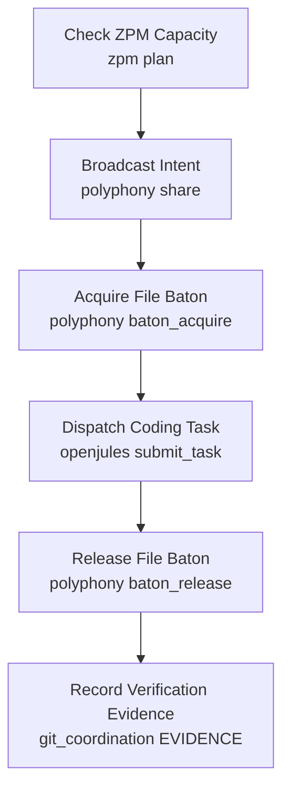

# Distributed LLM Coding System Architecture

This document describes the design and integration of the 3-tier distributed LLM coding system deployed across the cluster:
1. **[Keystone Polyphony](https://github.com/LokiMetaSmith/keystone-polyphony)**: Decentralized swarm coordination, distributed CRDT memory, mutex/baton concurrency locks, liminal bridge, and task authority.
2. **[OpenJules](https://github.com/LokiMetaSmith/OpenJules)**: Autonomous coding agent execution runtime, Docker sandboxes (DinD), the Propose–Probe–Compose adaptive harness, LLM inference broker, and multi-forge integration.
3. **[Zero Point Modulator (ZPM)](https://github.com/niklas-olsson/zero-point-modulator)**: Repository enrollment, worker capacity reconciliation, connecting Polyphony authority with OpenJules worker instances.

---

## 1. System Topology & Component Responsibilities

```
 ┌───────────────────────────────────────────────────────────────┐
 │               Zero Point Modulator (ZPM)                      │
 │   - Repository Enrollment (`zpm enroll`)                      │
 │   - Desired Worker Capacity Scaling (`zpm target`)            │
 │   - Resilient Reconciliation Loop (`zpm reconcile`)           │
 └──────────────┬───────────────────────────────┬────────────────┘
                │                               │
                ▼ (Durable Dispatch & Ensure)   ▼ (Protected Task Authority)
 ┌──────────────────────────────┐ ┌──────────────────────────────┐
 │          OpenJules           │ │      Keystone Polyphony      │
 │ - Docker-in-Docker Sandboxes │ │ - Swarm Mutex / Batons       │
 │ - Propose-Probe-Compose Loop │ │ - Liminal Bridge Broadcast   │
 │ - Local LLM Inference Broker │ │ - CRDT Shared State & Memory │
 │ - Multi-Forge (GitHub/Rad)   │ │ - Task Claims & Completions  │
 └──────────────────────────────┘ └──────────────────────────────┘
```

### Component Breakdown

| Component | Repository | Role in Distributed System |
| :--- | :--- | :--- |
| **Keystone Polyphony** | `https://github.com/LokiMetaSmith/keystone-polyphony` | Swarm coordination, file-level mutex batons (`baton_acquire`/`baton_release`), liminal bridge thoughts, and task authority. |
| **OpenJules** | `https://github.com/LokiMetaSmith/OpenJules` | Sandboxed worker execution, executing adaptive repair loops (Propose–Probe–Compose) against codebases with local LLM broker. |
| **Zero Point Modulator** | `https://github.com/niklas-olsson/zero-point-modulator` | Controls repository enrollment, schedules and scales worker capacity, and reconciles worker lifecycle intents between Polyphony and OpenJules. |

---

## 2. Infrastructure & Nomad Service Integration

The three services run as coordinated services on Nomad with Consul registration:

- **`polyphony` Nomad Job** (`ansible/roles/polyphony/templates/polyphony.nomad.j2`):
  - Service: `polyphony-api`
  - Consul tags: `["polyphony", "api"]`
  - Health check: HTTP `/health`
- **`openjules` Nomad Job** (`ansible/roles/openjules/templates/openjules.nomad.j2`):
  - Service: `openjules-api`
  - Consul tags: `["openjules", "api", "coding-agent", "distributed-swe"]`
  - Port: 8000
  - Health check: HTTP `/health`
- **`zero-point-modulator` Nomad Job** (`ansible/roles/zero_point_modulator/templates/zpm.nomad.j2`):
  - Service: `zpm-controller`
  - Consul tags: `["zpm", "reconciler", "distributed-coding", "llm-controller"]`
  - Daemon reconciler with `--watch` polling interval.

---

## 3. Pipecat Agent Tools

Pipecat agents interact with the distributed system using three dedicated tools registered in `TOOL_CLASS_MAP`:

1. **`PolyphonyTool` (`pipecatapp/tools/polyphony_tool.py`)**:
   - `share`: Broadcast thought to swarm.
   - `ping`: Notify a specific node.
   - `task_add`, `task_list`, `task_claim`, `task_complete`: Swarm backlog management.
   - `baton_acquire`: Acquire file-level or resource-level lock before writing code.
   - `baton_release`: Release mutex lock after verification.
   - `status`: Swarm status overview.

2. **`OpenJulesTool` (`pipecatapp/tools/openjules_tool.py`)**:
   - `submit_task`: Submit autonomous coding, bug repair, or PR review prompt.
   - `capabilities`: Inspect runtime capabilities (`/api/workers/capabilities`).
   - `list_workers`: Discover active worker instances.
   - `observe_worker`: Inspect worker status and active child execution.
   - `drain_worker` / `stop_worker`: Order graceful shutdown or termination.
   - `health`: Service health check.

3. **`ZeroPointModulatorTool` / `ZPMTool` (`pipecatapp/tools/zpm_tool.py`)**:
   - `status`: Inspect worker count and repository enrollment.
   - `plan`: Check capacity deficit and blocking reasons.
   - `enroll`: Enroll a repository configuration.
   - `target`: Adjust desired worker capacity.
   - `pause` / `resume`: Pause or resume repository worker dispatch.
   - `reconcile`: Trigger immediate reconciliation tick against OpenJules provider.

---

## 4. Orchestration Workflow

The orchestration loop is codified in `workflows/distributed_llm_coding_loop.yaml`:


